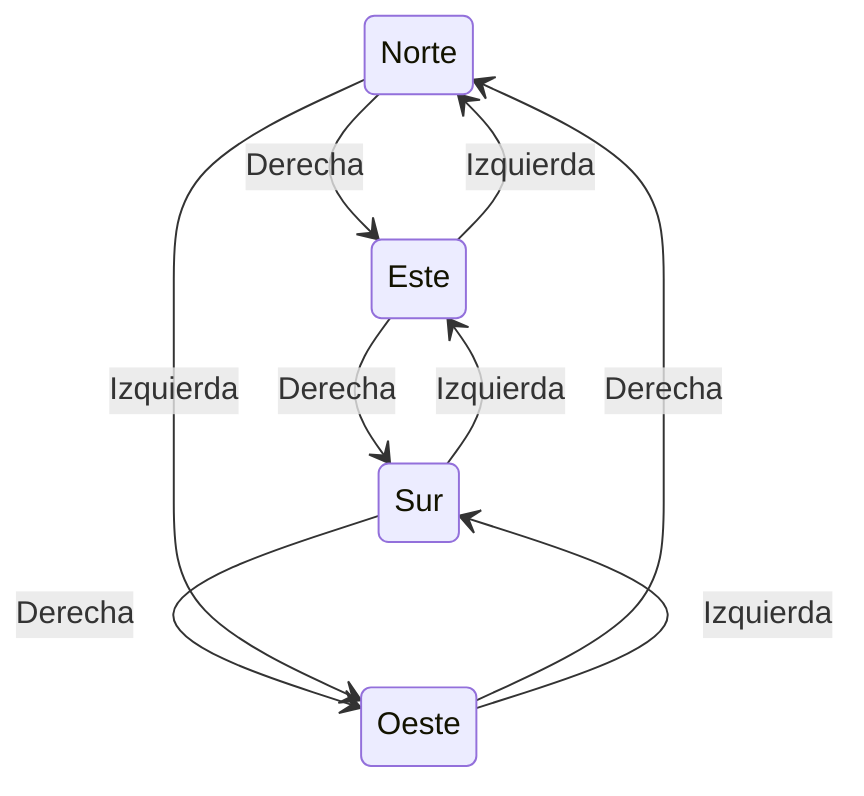
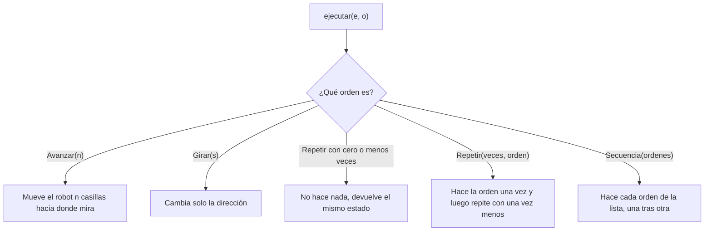
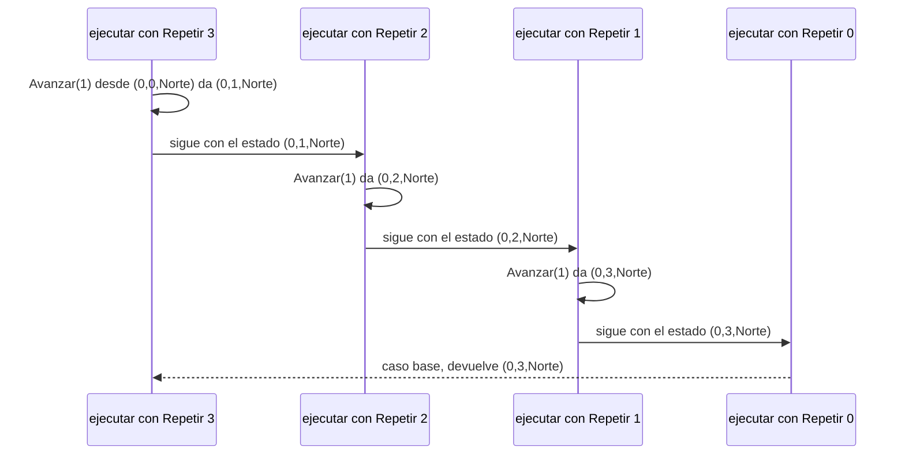
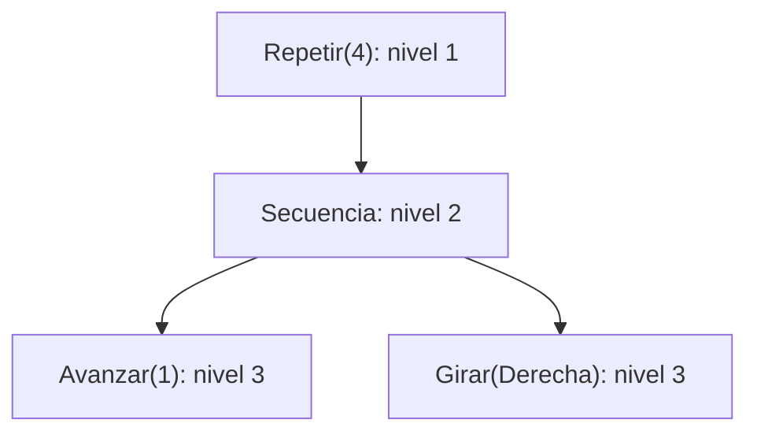
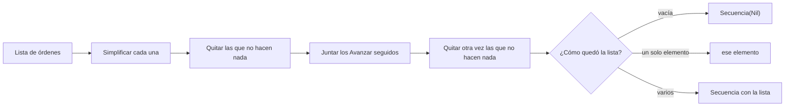

# Informe de proceso: Taller 2, el robot en la cuadrícula


Aquí contamos, punto por punto, cómo trabaja cada función y por dónde va pasando el robot. Las funciones están en RobotCuadricula.scala. Los tipos (Direccion, Sentido, Orden, Estado) vienen en Modelo.scala, que no tocamos.

## Antes de empezar

- El estado del robot lo escribimos como (x, y, mira). Arranca en inicial = (0, 0, Norte).
- Si avanza hacia el **Norte** sube en y, hacia el **Sur** baja en y, hacia el **Este** sube en x y hacia el **Oeste** baja en x.
- En las tablas de traza cada fila es un paso: qué orden se hizo y dónde quedó el robot.

## El código que vamos a explicar

Estas son las funciones tal como quedaron en RobotCuadricula.scala. Más abajo se explica cada una.

```
def girar(d: Direccion, s: Sentido): Direccion = (d, s) match {
  case (Norte, Derecha)   => Este
  case (Este, Derecha)    => Sur
  case (Sur, Derecha)     => Oeste
  case (Oeste, Derecha)   => Norte
  case (Norte, Izquierda) => Oeste
  case (Oeste, Izquierda) => Sur
  case (Sur, Izquierda)   => Este
  case (Este, Izquierda)  => Norte
}

def ejecutar(e: Estado, o: Orden): Estado = o match {
  case Avanzar(n) =>
    e.mira match {
      case Norte => e.copy(y = e.y + n)
      case Este  => e.copy(x = e.x + n)
      case Sur   => e.copy(y = e.y - n)
      case Oeste => e.copy(x = e.x - n)
    }
  case Girar(s) => e.copy(mira = girar(e.mira, s))
  case Repetir(veces, _) if veces <= 0 => e
  case Repetir(veces, orden) =>
    ejecutar(ejecutar(e, orden), Repetir(veces - 1, orden))
  case Secuencia(ordenes) =>
    ordenes.foldLeft(e)((acc, x) => ejecutar(acc, x))
}

def cuantasBasicas(o: Orden): Int = o match {
  case Avanzar(_) => 1
  case Girar(_)   => 1
  case Repetir(veces, _) if veces <= 0 => 0
  case Repetir(veces, orden) => veces * cuantasBasicas(orden)
  case Secuencia(ordenes) => ordenes.map(x => cuantasBasicas(x)).sum
}

def profundidad(o: Orden): Int = o match {
  case Avanzar(_) => 1
  case Girar(_)   => 1
  case Repetir(_, orden) => 1 + profundidad(orden)
  case Secuencia(ordenes) =>
    1 + ordenes.map(x => profundidad(x)).foldLeft(0)((a, b) => math.max(a, b))
}

def componer(o1: Orden, o2: Orden): Orden = Secuencia(List(o1, o2))

def rutina(pasos: Int)(giro: Sentido)(veces: Int): Orden =
  Repetir(veces, Secuencia(List(Avanzar(pasos), Girar(giro))))

def aplicarA(estados: List[Estado], o: Orden): List[Estado] =
  estados.map(e => ejecutar(e, o))

def transformar(o: Orden, f: Orden => Orden): Orden = o match {
  case Repetir(veces, orden) => Repetir(veces, transformar(orden, f))
  case Secuencia(ordenes)    => Secuencia(ordenes.map(x => transformar(x, f)))
  case basica                => f(basica)
}

def simplificar(o: Orden): Orden = {

  def nada(x: Orden): Boolean = x match {
    case Secuencia(Nil) => true
    case Avanzar(0)     => true
    case _              => false
  }

  def juntar(os: List[Orden]): List[Orden] = os match {
    case Avanzar(a) :: Avanzar(b) :: resto => juntar(Avanzar(a + b) :: resto)
    case x :: resto                        => x :: juntar(resto)
    case Nil                               => Nil
  }

  o match {
    case Avanzar(0) => Secuencia(Nil)
    case Repetir(veces, _) if veces <= 0 => Secuencia(Nil)
    case Repetir(1, orden) => simplificar(orden)
    case Repetir(veces, orden) =>
      simplificar(orden) match {
        case s if nada(s) => Secuencia(Nil)
        case s            => Repetir(veces, s)
      }
    case Secuencia(ordenes) =>
      juntar(ordenes.map(x => simplificar(x)).filterNot(x => nada(x))).filterNot(x => nada(x)) match {
        case Nil      => Secuencia(Nil)
        case x :: Nil => x
        case xs       => Secuencia(xs)
      }
    case otra => otra
  }
}
```

---

## Punto 1: girar

### Cómo funciona

girar mira a la vez hacia dónde está mirando el robot y hacia qué lado gira, y con eso decide la nueva dirección. Son ocho casos: cuatro direcciones por dos lados. No necesita if ni repetir nada.



### Traza

Cuatro giros seguidos a la derecha, empezando mirando al Norte:

| Paso | Llamado | Resultado |
|------|---------|-----------|
| 1 | girar(Norte, Derecha) | Este |
| 2 | girar(Este, Derecha) | Sur |
| 3 | girar(Sur, Derecha) | Oeste |
| 4 | girar(Oeste, Derecha) | Norte |

Al cuarto giro el robot vuelve a mirar al Norte. Con la izquierda pasa lo mismo, pero en sentido contrario.

---

## Punto 2: ejecutar

### Cómo funciona

ejecutar recibe un estado y una orden, y devuelve el estado en que queda el robot. Revisa qué clase de orden es y hace lo que corresponde:



1. **Avanzar(n):** según hacia dónde mira, se le suma o resta n a x o a y. Si n es negativo, el robot retrocede.
2. **Girar(s):** el robot se queda en la misma casilla y solo cambia hacia dónde mira, usando girar.
3. **Repetir con cero o menos veces:** no hace nada. Este es el caso en que la repetición se detiene.
4. **Repetir(veces, orden):** ejecuta la orden una vez y con el estado nuevo vuelve a llamar a Repetir pero con una vez menos. Así va bajando hasta llegar a cero.
5. **Secuencia:** parte del estado actual y le va aplicando cada orden de la lista, de izquierda a derecha. Cada orden arranca donde terminó la anterior. Con la lista vacía el robot no se mueve.

### Traza 2.a: ejecutar(inicial, Avanzar(3))

| Paso | Orden | Estado |
|------|-------|--------|
| 0 | (inicio) | (0, 0, Norte) |
| 1 | Avanzar(3), mirando al Norte sube 3 en y | (0, 3, Norte) |

### Traza 2.b: Secuencia(List(Avanzar(2), Girar(Derecha), Avanzar(4)))

| Paso | Orden | Estado |
|------|-------|--------|
| 0 | (inicio) | (0, 0, Norte) |
| 1 | Avanzar(2) | (0, 2, Norte) |
| 2 | Girar(Derecha): del Norte pasa al Este | (0, 2, Este) |
| 3 | Avanzar(4), mirando al Este sube 4 en x | (4, 2, Este) |

### Traza 2.c: el cuadrado

La orden es Repetir(4, Secuencia(List(Avanzar(1), Girar(Derecha)))). Llamamos o a lo que va dentro, o sea avanzar uno y girar a la derecha. Por dentro, el Repetir se va desarmando así:

```
ejecutar(e0, Repetir(4, o))  = ejecutar(ejecutar(e0, o), Repetir(3, o))
                             = ejecutar(ejecutar(e1, o), Repetir(2, o))
                             = ejecutar(ejecutar(e2, o), Repetir(1, o))
                             = ejecutar(ejecutar(e3, o), Repetir(0, o))
                             = e4
```

Y los pasos del robot son estos:

| Vuelta | Orden | Estado |
|--------|-------|--------|
| 0 | (inicio) | (0, 0, Norte) |
| 1 | Avanzar(1) | (0, 1, Norte) |
| 1 | Girar(Derecha) | (0, 1, Este) |
| 2 | Avanzar(1) | (1, 1, Este) |
| 2 | Girar(Derecha) | (1, 1, Sur) |
| 3 | Avanzar(1) | (1, 0, Sur) |
| 3 | Girar(Derecha) | (1, 0, Oeste) |
| 4 | Avanzar(1) | (0, 0, Oeste) |
| 4 | Girar(Derecha) | (0, 0, Norte) |

El robot dibuja un cuadrado y termina en (0, 0, Norte), justo donde empezó y mirando hacia donde miraba.

### Diagrama de llamados de Repetir

Para ver cómo se encadenan los llamados con un ejemplo más corto, tomamos Repetir(3, Avanzar(1)) desde el origen. Cada llamado a Repetir hace la orden una vez y le pasa el nuevo estado al siguiente, con una vuelta menos. Cuando llegan a cero, devuelve el estado final.



Es la misma idea que el cuadrado de la traza anterior, solo que con una orden más sencilla. En cada paso el resultado parcial viaja en el estado, y por eso el último llamado ya tiene la respuesta completa y la devuelve sin más cuentas.


### Traza 2.d y 2.e

| Llamado | Qué pasa | Resultado |
|---------|----------|-----------|
| ejecutar(inicial, Avanzar(-2)) | mira al Norte, así que retrocede 2 | (0, -2, Norte) |
| ejecutar(inicial, Repetir(0, Avanzar(5))) | cero veces, no hace nada | (0, 0, Norte) |

---

## Punto 3: cuantasBasicas y profundidad

Estas dos funciones solo **miden** la orden, no la ejecutan, así que el robot no se mueve. Lo que sí podemos hacer es comprobar que los números cuadran con lo que vimos en las trazas.

### cuantasBasicas

Cuenta cuántos Avanzar y Girar se llegan a hacer:

- Un Avanzar o un Girar cuenta 1.
- Un Repetir con cero o menos veces cuenta 0.
- Un Repetir(veces, orden) cuenta veces multiplicado por lo que cuenta la orden de adentro.
- Una Secuencia suma lo que cuenta cada orden de la lista. Si está vacía, suma 0.

Para el cuadrado:

```
cuantasBasicas(Repetir(4, Secuencia(List(Avanzar(1), Girar(Derecha)))))
  = 4 * (cuantasBasicas(Avanzar(1)) + cuantasBasicas(Girar(Derecha)))
  = 4 * (1 + 1)
  = 8
```

Esos 8 son las 8 filas de la traza 2.c: cuatro Avanzar y cuatro Girar. Otro ejemplo con repeticiones una dentro de otra: Repetir(2, Repetir(3, Avanzar(1))) cuenta 2 * (3 * 1) = 6.

### profundidad

Dice cuántos niveles de órdenes metidas unas dentro de otras tiene una orden:

- Avanzar y Girar valen 1.
- Repetir(\_, orden) vale 1 más lo que vale la orden de adentro.
- Secuencia vale 1 más lo que vale la más honda de su lista. Si la lista está vacía, vale 1.

El cuadrado visto como un árbol, donde cada piso es un nivel:



```
profundidad(cuadrado) = 1 + (1 + max(1, 1)) = 3
```

Otros casos: profundidad(Avanzar(3)) = 1, profundidad(Secuencia(Nil)) = 1 y profundidad(Repetir(2, Repetir(3, Avanzar(1)))) = 3.

---

## Punto 4: rutinas con funciones de alto orden

### componer

Solo arma Secuencia(List(o1, o2)): la primera orden y después la segunda. No mueve nada por sí sola; el movimiento ocurre cuando se ejecuta.

Traza con componer(Avanzar(2), Girar(Izquierda)) desde inicial:

| Paso | Orden | Estado |
|------|-------|--------|
| 0 | (inicio) | (0, 0, Norte) |
| 1 | Avanzar(2) | (0, 2, Norte) |
| 2 | Girar(Izquierda): del Norte pasa al Oeste | (0, 2, Oeste) |

### rutina

Funciona en dos tiempos. rutina(1)(Derecha) todavía no hace nada: queda esperando cuántas veces repetir. Cuando le damos las veces, devuelve Repetir(veces, Secuencia(List(Avanzar(pasos), Girar(giro)))).

Si hacemos val cuadradoDe = rutina(1)(Derecha), entonces cuadradoDe(4) es exactamente la orden del cuadrado del punto 2, así que su traza es la 2.c y termina en (0, 0, Norte).

### aplicarA

Hace la misma orden sobre cada estado de la lista, uno por uno y sin mezclarlos. Para aplicarA(List(inicial, Estado(5, 5, Sur)), Avanzar(2)):

| Estado de entrada | Orden | Estado de salida |
|-------------------|-------|------------------|
| (0, 0, Norte) | Avanzar(2), sube 2 en y | (0, 2, Norte) |
| (5, 5, Sur) | Avanzar(2), baja 2 en y | (5, 3, Sur) |

Con una lista vacía devuelve una lista vacía.

### transformar

Recorre la orden y cambia cada Avanzar o Girar por lo que devuelva la función f, pero respetando cómo están armadas las repeticiones y las secuencias. Los Repetir conservan sus veces y las Secuencia conservan sus elementos; solo cambian las órdenes de las puntas.

Si duplicamos los avances del cuadrado, queda Repetir(4, Secuencia(List(Avanzar(2), Girar(Derecha)))). Su traza:

| Paso | Orden | Estado |
|------|-------|--------|
| 0 | (inicio) | (0, 0, Norte) |
| 1 | Avanzar(2) | (0, 2, Norte) |
| 2 | Girar(Derecha) | (0, 2, Este) |
| 3 | Avanzar(2) | (2, 2, Este) |
| 4 | Girar(Derecha) | (2, 2, Sur) |
| 5 | Avanzar(2) | (2, 0, Sur) |
| 6 | Girar(Derecha) | (2, 0, Oeste) |
| 7 | Avanzar(2) | (0, 0, Oeste) |
| 8 | Girar(Derecha) | (0, 0, Norte) |

Es un cuadrado de lado 2 y también vuelve al punto de partida.

---

## Punto 5: simplificar

### Cómo funciona

simplificar busca una orden que haga lo mismo pero más corta. Para eso usa dos ayudantes que están dentro de la misma función:

- nada: dice si una orden no hace nada, que pasa con Secuencia(Nil) y con Avanzar(0).
- juntar: recorre una lista y, cuando encuentra dos Avanzar seguidos, los cambia por uno solo con la suma. Si hay tres o más seguidos, los junta todos.

Y según la orden que le llegue, hace esto:

1. Avanzar(0) se vuelve Secuencia(Nil).
2. Repetir con cero o menos veces se vuelve Secuencia(Nil).
3. Repetir(1, orden) se vuelve la orden simplificada, sin el Repetir.
4. Cualquier otro Repetir simplifica lo de adentro; si lo de adentro no hace nada, todo se vuelve Secuencia(Nil), y si sí hace algo se queda como Repetir.
5. Una Secuencia sigue el camino del diagrama de abajo.
6. Un Avanzar distinto de cero o un Girar se dejan como están.



Quitamos dos veces las órdenes que no hacen nada porque al sumar avances opuestos puede aparecer un Avanzar(0) nuevo (se ve en la traza 5.f).

### Traza 5.a: Secuencia(List(Avanzar(2), Avanzar(3)))

1. Cada orden se simplifica y quedan igual.
2. No hay nada que quitar.
3. juntar suma los dos avances y queda Avanzar(5).
4. Como la lista tiene un solo elemento, el resultado es Avanzar(5).

| | Original | Simplificada |
|---|----------|--------------|
| Orden | Secuencia(List(Avanzar(2), Avanzar(3))) | Avanzar(5) |
| Posiciones | (0,0,N), (0,2,N), (0,5,N) | (0,0,N), (0,5,N) |

Las dos terminan en (0, 5, Norte).

### Traza 5.b: Repetir(1, Avanzar(4))

Entra al caso de repetir una sola vez y devuelve Avanzar(4). Las dos terminan en (0, 4, Norte).

### Traza 5.c: Secuencia(List(Avanzar(0), Girar(Derecha)))

1. Avanzar(0) se vuelve Secuencia(Nil), y Girar(Derecha) se queda igual.
2. Se quita lo que no hace nada y queda [Girar(Derecha)].
3. Un solo elemento: el resultado es Girar(Derecha).

Las dos terminan en (0, 0, Este).

### Traza 5.d: Secuencia(List(Avanzar(1), Avanzar(2), Girar(Derecha), Avanzar(3)))

juntar suma el Avanzar(1) y el Avanzar(2) en un Avanzar(3). El Girar separa al último Avanzar(3), así que ese no se junta con los anteriores. Queda Secuencia(List(Avanzar(3), Girar(Derecha), Avanzar(3))).

| | Original | Simplificada |
|---|----------|--------------|
| Posiciones | (0,0,N), (0,1,N), (0,3,N), (0,3,E), (3,3,E) | (0,0,N), (0,3,N), (0,3,E), (3,3,E) |

Las dos terminan en (3, 3, Este).

### Traza 5.e: Repetir(0, Avanzar(9))

Cero repeticiones no hacen nada, así que se vuelve Secuencia(Nil). Las dos dejan al robot en (0, 0, Norte).

### Traza 5.f: Secuencia(List(Avanzar(4), Avanzar(-4), Girar(Izquierda)))

Este caso muestra para qué sirve la segunda limpieza.

1. Al principio no hay nada que quitar.
2. juntar suma 4 y -4 y sale Avanzar(0). La lista queda [Avanzar(0), Girar(Izquierda)].
3. La segunda limpieza quita el Avanzar(0) y queda [Girar(Izquierda)].
4. El resultado es Girar(Izquierda).

| | Original | Simplificada |
|---|----------|--------------|
| Posiciones | (0,0,N), (0,4,N), (0,0,N), (0,0,O) | (0,0,N), (0,0,O) |

Las dos terminan en (0, 0, Oeste).

### Traza 5.g: Repetir(3, Secuencia(List(Avanzar(0))))

1. Se simplifica lo de adentro: el Avanzar(0) desaparece y la secuencia queda vacía, o sea Secuencia(Nil).
2. Como lo de adentro no hace nada, repetirlo tres veces tampoco hace nada, y todo se vuelve Secuencia(Nil).

La orden original no mueve al robot y la simplificada tampoco.